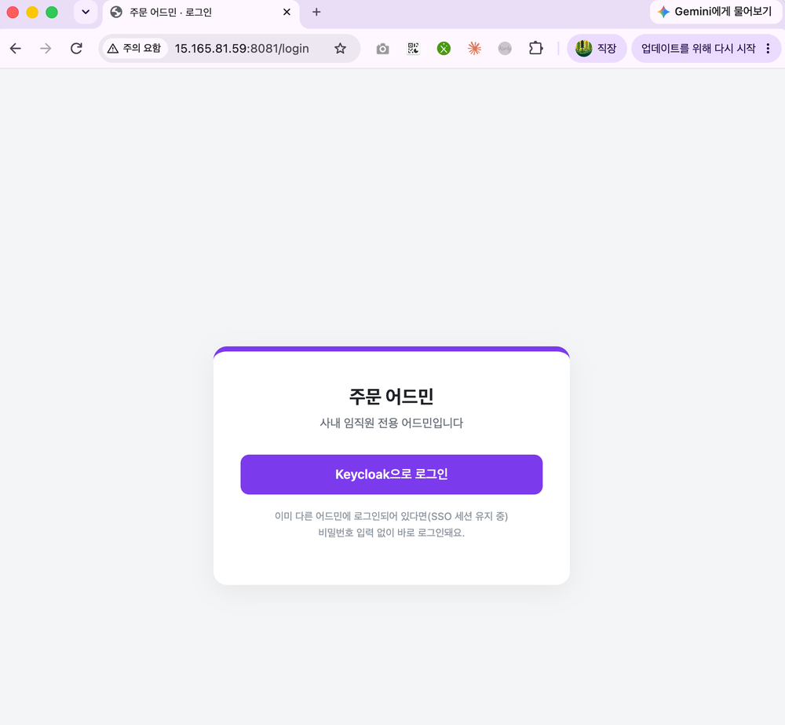
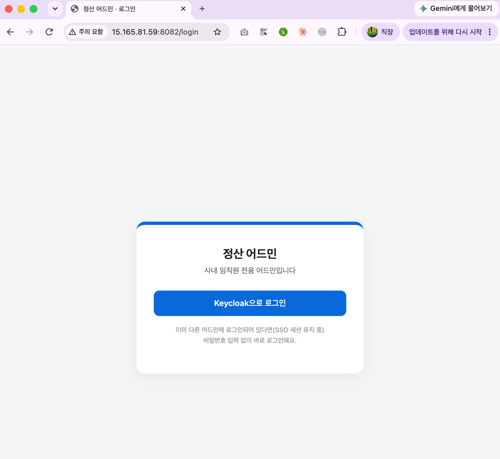
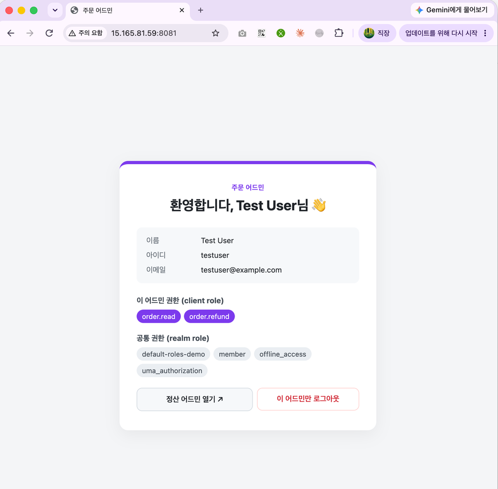
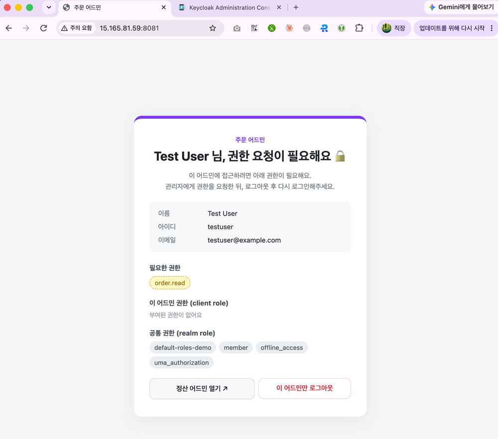
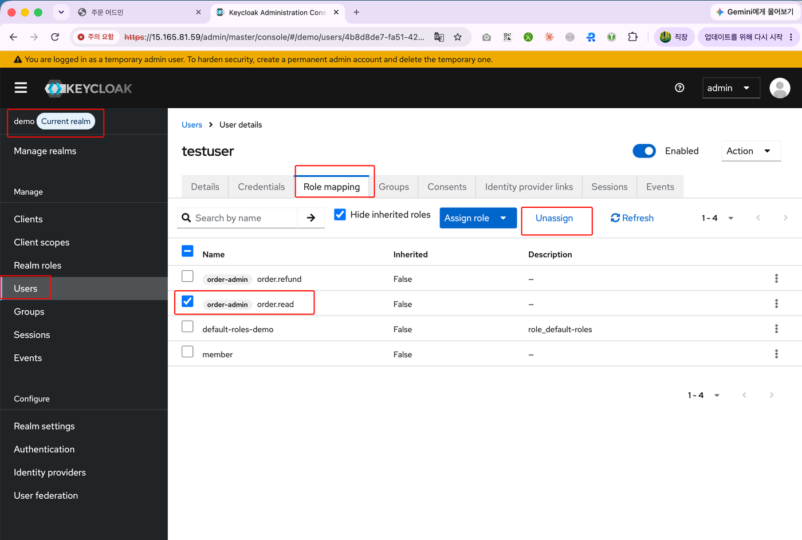

# keycloak-admin-demo

사내 어드민 임직원 로그인 관리를 위한 **Keycloak PoC**용 예시 어드민 서버입니다.
같은 코드를 client 설정만 바꿔 **주문 어드민 / 정산 어드민** 2개로 띄워 SSO, 어드민별 로그아웃, 권한 체크를 확인합니다.

## 접속 주소 (사내 와이파이에서만 접근 가능)

| 구분 | URL | 비고 |
|---|---|---|
| Keycloak 관리 콘솔 | https://15.165.81.59 | 자체서명 인증서 → 브라우저 경고에서 `고급 → 이동`. 관리자 계정은 Slack 스레드 참고 |
| 주문 어드민 | http://15.165.81.59:8081 | client: `order-admin`, 필수 권한: `order.read` |
| 정산 어드민 | http://15.165.81.59:8082 | client: `settle-admin`, 필수 권한: `settle.read` |
| **어드민 포털** | http://15.165.81.59:8083 | client: `admin-portal`. 어드민 등록 · 권한 관리 · 권한 신청/결재 ([아래 설명](#어드민-포털-portal)) |

- 테스트 계정: `demo` realm의 `testuser` (비밀번호는 Slack 스레드 참고)
- 서버: playground 계정 EC2 `seongyeol-test` (Keycloak 26.4 dev 모드 + 어드민 2개, 모두 Docker)

## 동작 시나리오

1. 미로그인 접근 → 어드민 자체 로그인 화면("Keycloak으로 로그인" 버튼)
2. 버튼 클릭 → Keycloak 로그인 → 이름 / 아이디 / 이메일 / 권한 표시
3. 다른 어드민에서 버튼 클릭 → SSO 세션이 있으므로 **비밀번호 없이 원클릭 로그인**
4. "이 어드민만 로그아웃" → 해당 어드민만 로그아웃, 다른 어드민과 SSO 세션은 유지
5. 필수 권한이 없으면 403 + **"OOO 님, 권한 요청이 필요해요"** 화면 (필요한 권한 표시)

## 스크린샷

### 1. 로그인 화면 (주문 / 정산)
미로그인 상태로 접근하면 Keycloak으로 바로 보내지 않고 버튼 화면을 먼저 보여줍니다. SSO 세션이 있으면 버튼 클릭만으로 로그인됩니다.

| 주문 어드민 | 정산 어드민 |
|---|---|
|  |  |

### 2. 로그인 후 화면
이름 / 아이디 / 이메일과 이 어드민의 client role, 공통 realm role을 표시합니다.



### 3. 권한이 없을 때
필수 권한(`order.read`)이 없으면 403과 함께 권한 요청 화면을 보여주고, 필요한 권한을 노란색으로 표시합니다.



### 4. Keycloak에서 권한 회수
`demo` realm → Users → testuser → **Role mapping** → `order.read` 선택 → **Unassign** 후, 어드민에서 로그아웃 → 재로그인하면 위 3번 화면이 됩니다.
(그룹에서 상속받은 권한은 **Hide inherited roles** 체크를 해제해야 보입니다.)



## 구조

```
Browser ──(1) 로그인 화면 이동 ──▶ Keycloak (https://15.165.81.59)
   │                                      ▲
   ▼                                      │ (2) token / userinfo / revoke
Admin (Spring Boot) ─────── docker network (http://keycloak:8080) ─┘
```

- 브라우저 리다이렉트는 **public URL**, 서버 간 통신(토큰 교환, JWKS, userinfo, revoke)은 **docker 내부망**으로 분리
- Keycloak은 `KC_HOSTNAME=https://15.165.81.59` + `KC_HOSTNAME_BACKCHANNEL_DYNAMIC=true`로 어느 경로로 호출해도 토큰 issuer가 동일하게 유지됨

## 코드 설명

```
src/main/java/com/example/admin/
├── SecurityConfig.java          # 보안 설정 핵심
├── LocalOnlyLogoutHandler.java  # "이 어드민만" 로그아웃
├── HomeController.java          # 환영 화면 / 권한 요청 화면
└── AdminApplication.java
src/main/resources/
├── application.properties       # Keycloak 연동 설정 (환경변수로 주입)
└── templates/login.html, home.html
deploy/                          # EC2 배포·검증 스크립트
```

### SecurityConfig.java
- `oauth2Login().loginPage("/login")` : 미로그인 시 Keycloak으로 바로 보내지 않고 버튼 화면을 먼저 보여줌 (원클릭 로그인)
- **role 변환** (`keycloakOidcUserService`) : Keycloak은 role을 ID token이 아니라 **access token**에 담음
  - `resource_access.{clientId}.roles` → `ROLE_{role}` (이 어드민의 client role, `hasRole()`로 사용 가능)
  - `realm_access.roles` → `REALM_{role}`
- **권한 체크** (`hasAllRoles`) : `REQUIRED_ROLES`를 모두 가진 사용자만 접근. 없으면 `/denied`(403)로 forward

### LocalOnlyLogoutHandler.java
- Keycloak `end_session`(= SSO 전체 로그아웃)은 호출하지 않음
- 이 어드민의 refresh token만 `/protocol/openid-connect/revoke`로 폐기 → Keycloak에서 **이 client 세션만** 제거, SSO 세션 유지
- 로컬 세션 삭제는 Spring Security 기본 로그아웃 핸들러가 처리

### application.properties (환경변수)

| 변수 | 설명 | 예시 |
|---|---|---|
| `APP_NAME` / `APP_COLOR` | 화면 표시용 이름 / 색상 | `주문 어드민` / `#7c3aed` |
| `APP_COOKIE` | 세션 쿠키 이름. 같은 호스트에 포트만 다른 어드민을 띄우므로 분리 필수 (쿠키는 포트를 구분하지 않음) | `ORDER_ADMIN_SESSION` |
| `CLIENT_ID` / `CLIENT_SECRET` | Keycloak client 정보 | `order-admin` |
| `REQUIRED_ROLES` | 접근 필수 client role (콤마 구분, 모두 필요) | `order.read` |
| `KC_PUBLIC_URL` | 브라우저가 접근하는 Keycloak 주소 | `https://15.165.81.59` |
| `KC_INTERNAL_URL` | 서버가 호출하는 Keycloak 주소 | `http://keycloak:8080` |
| `KC_REALM` | realm | `demo` |
| `OTHER_NAME` / `OTHER_URL` | 화면의 "다른 어드민 열기" 링크 | |

## Keycloak 구성 (`demo` realm)

| 항목 | 내용 |
|---|---|
| Client | `order-admin` (redirect `http://15.165.81.59:8081/*`), `settle-admin` (redirect `http://15.165.81.59:8082/*`) |
| Client role | `order.read`, `order.refund` / `settle.read`, `settle.approve` |
| Group | `정산팀` → `settle.read` 부여 |
| testuser | `order.read`, `order.refund` 직접 부여 + `정산팀` 소속 (→ `settle.read` 상속) |

## 배포 (EC2에서 실행)

```bash
# 1) Keycloak 재기동(hostname 고정) + client/role/group 생성 → /opt/keycloak-test/admins.env 에 client secret 저장
./deploy/setup-keycloak.sh

# 2) 이미지 빌드 + 어드민 2개 실행 (8081, 8082)
./deploy/run-admins.sh

# 3) 검증
./deploy/e2e.sh            # 로그인 → SSO 원클릭 → 한쪽 로그아웃 → 재로그인
./deploy/verify-denied.sh  # 권한 회수 → 차단 화면 확인 → 원복
```

## 알아둘 점

- **권한 변경은 재로그인 후 반영**: 권한은 로그인 시 받은 토큰 기준이라, Keycloak에서 바꿔도 이미 로그인된 어드민에는 즉시 반영되지 않음
- **발급된 access token은 만료 전까지 유효**: 즉시 차단이 필요하면 짧은 토큰 수명, Backchannel Logout, introspection 등을 검토
- PoC용 구성: Keycloak dev 모드(H2 DB), 자체서명 인증서, 어드민은 HTTP. 운영 시 DB·이중화·정식 인증서 필요

---

## 어드민 포털 (`portal/`)

Keycloak 관리 콘솔은 **우리 팀만** 쓰고, 타팀 실무자는 이 포털에서 필요한 작업만 하도록 만든 커스텀 관리 화면입니다.
포털 백엔드가 **서비스 계정(client_credentials)** 으로 Keycloak **Admin REST API** 를 호출합니다. 브라우저는 Admin API를 직접 호출하지 않습니다.

```
타팀 실무자 브라우저 ──(Keycloak SSO 로그인)──▶ 어드민 포털 (Spring Boot, :8083)
                                                   │ ① 포털 권한 체크 (소유자 / portal-admin)
                                                   │ ② 감사 로그 기록 (H2)
                                                   ▼ ③ 서비스 계정 토큰으로 호출
                                          Keycloak Admin REST API (/admin/realms/demo/...)
```

### 기능

| 메뉴 | 기능 |
|---|---|
| 대시보드 | 내 어드민별 보유 권한(그룹 상속 포함), 최근 내 신청 |
| 어드민 관리 | **어드민(OAuth client) 등록** → Keycloak confidential client 생성, redirect URI `{주소}/*`로 제한, secret 1회 노출 / 소유자 변경 / secret 재발급 |
| 어드민 상세 | **어드민별 권한(client role) 생성·삭제**, role별 부여된 임직원·그룹 조회, 부여·회수 |
| 임직원 | 검색, 소속 그룹 추가·제외, 어드민별 권한 부여·회수 (직접 부여 / 그룹 상속 구분 표시) |
| 그룹 | 생성, 멤버 추가·제외, 그룹 권한 부여·회수 (멤버 전원 상속) |
| 권한 신청·결재 | **임직원 권한 신청 → 결재(승인/반려) → 승인 시 Keycloak에 role 자동 부여**, 신청 취소, 결재 이력 |
| 감사 로그 | 포털에서 일어난 모든 변경 (실행자 / 작업 / 대상) |

### 권한 규칙 (가드레일)

| 작업 | 허용 대상 |
|---|---|
| 어드민 등록 | 로그인한 누구나 → **등록자가 소유자** |
| 어드민 권한 생성·삭제, 임직원/그룹에 권한 부여·회수, secret 재발급 | **해당 어드민 소유자** 또는 `portal-admin` |
| 그룹 생성, 그룹 멤버 변경 | 로그인한 누구나 (PoC. 운영 시 그룹 관리자 개념 필요) |
| 권한 신청 승인·반려 | **신청자 본인 셀프 승인 (PoC)** / 소유자 / `portal-admin` |

- `portal-admin` = `admin-portal` client의 role. **우리 팀에게만** Keycloak 콘솔에서 부여
- 포털은 **포털에 등록된 어드민의 role만** 다룸. `realm-management` 등 Keycloak 내장 client는 등록·조회 불가 → 권한 상승 방지
- 서비스 계정 권한은 최소한으로: `manage-clients, view-clients, query-clients, manage-users, view-users, query-users, query-groups`
- Keycloak admin event에는 실행자가 "포털 서비스 계정"으로만 남으므로, **실제 실행자는 포털 감사 로그**에 기록

### 초기 데이터
- 기존 예시 어드민을 포털 관리 대상으로 가져옴: `order-admin`(소유자 testuser), `settle-admin`(소유자 없음 → portal-admin만 변경)
- 그래서 testuser로 로그인하면 **주문 어드민은 관리 가능, 정산 어드민은 조회만** (소유자 체크 확인용)

### 코드 구조

```
portal/src/main/java/com/example/portal/
├── keycloak/KeycloakAdminClient.java   # Admin REST API 호출 (서비스 계정 토큰 캐시)
├── service/PortalService.java          # 비즈니스 로직 + 권한 규칙 + 감사 로그
├── service/SeedRunner.java             # 기존 client 가져오기
├── domain/                             # ManagedClient(소유자), AccessRequest(결재), AuditLog
├── security/                           # OIDC 로그인, portal-admin role 변환, 포털만 로그아웃
└── web/                                # Home / Client / Directory(임직원·그룹) / Request 컨트롤러
portal/deploy/
├── setup-portal.sh   # admin-portal client + 서비스 계정 권한 + portal-admin role
├── run-portal.sh     # 빌드 후 :8083 실행 (H2 데이터: /opt/keycloak-portal-data)
└── e2e-portal.sh     # 등록 → 권한 생성/부여 → 소유자 차단 → 신청/셀프 승인 → Keycloak 반영 확인
```

### 운영으로 가려면 (PoC와 다른 점)
- 셀프 승인 → 결재선(신청자 팀장 → 어드민 소유자 등)
- H2 → 운영 DB, 포털 이중화
- 그룹 관리 권한 모델 (그룹 관리자), 소유자 다중화(팀 단위 소유)
- client secret 전달 방식 (Vault 등), redirect URI 도메인 화이트리스트
